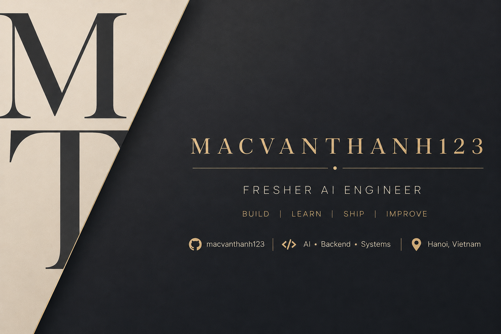



  <strong>Hi, I'm Mac Van Thanh</strong> 
  Fresher AI Engineer · Hanoi, Vietnam 
  Building, learning, and improving intelligent systems.

  

## About Me

I’m an AI & Data Science learner focused on building applications with LLMs, retrieval-augmented generation (RAG), and AI agents. I enjoy working across the full system: backend APIs, data retrieval, multi-stage pipelines, evaluation, and performance.

- Based in Hanoi, Vietnam
- Interested in reliable, measurable AI systems beyond the demo
- Currently exploring AI agents, LLM evaluation, and AI platform engineering

 

## Connect With Me

## Languages & Tools

**Languages** 

**AI & LLM Engineering** 
`LLMs` · `RAG` · `AI Agents` · `Embeddings` · `Vector Search` · `Hybrid Search` · `LLM Evaluation` · `MCP`

**Backend** 

**Frontend** 

**Data** 

**Tools** 

## Featured Projects

### TraVy — AI Travel Assistant

An AI travel assistant focused on destinations in Vietnam. It explores destination discovery, travel information retrieval, context-aware itinerary planning, and adapting plans to conversation context.

- **Architecture:** React and TypeScript frontend → NestJS backend → FastAPI AI service → LLM, retrieval, and external APIs
- **Engineering focus:** Intent routing, hybrid retrieval, multi-stage workflows, conversation history, external API failures, answer quality, prompt injection, guardrails, and response latency
- **Stack:** React · TypeScript · NestJS · FastAPI · Python · Supabase · LLM APIs

### AI Agent Evaluation Platform — In Development

A platform concept for testing and evaluating chatbot, RAG, and agent systems. Areas under exploration include golden datasets, offline evaluation, custom rubrics, regression checks, trace analysis, and evaluation reports.

- **Engineering focus:** Evaluation pipeline design, test data management, output comparison, and failure diagnosis
- **Related technologies:** Python · PostgreSQL · Docker · LLM APIs · MCP

### RAG-based University Admission Assistant — Research

A university admissions question-answering assistant exploring document processing, chunking, embeddings, semantic retrieval, and answers grounded in source material. The implementation is under research and design.

- **Related technologies:** Python · RAG · LLM APIs · Vector search

### Fire & Smoke Detection with YOLO — Research

A computer vision project exploring fire and smoke detection, from dataset preparation and model training to inference and ONNX export.

- **Related technologies:** Python · YOLOv8 · Computer vision · ONNX

## Currently Exploring

AI agent architectures · Multi-agent systems · LLM evaluation · LLMOps · AI observability · System design · Scalable AI applications · Model Context Protocol · AI infrastructure · Performance optimization

## GitHub Stats

  <picture>
    <source media="(prefers-color-scheme: dark)" srcset="https://github-readme-stats.vercel.app/api?username=macvanthanh123&show_icons=true&hide_border=true&bg_color=00000000&title_color=c4a96a&icon_color=c4a96a&text_color=c9c9c9" />
    
  </picture>
  <picture>
    <source media="(prefers-color-scheme: dark)" srcset="https://github-readme-stats.vercel.app/api/top-langs/?username=macvanthanh123&layout=compact&hide_border=true&bg_color=00000000&title_color=c4a96a&text_color=c9c9c9" />
    
  </picture>

## GitHub Activity

  

Build · Learn · Ship · Improve

